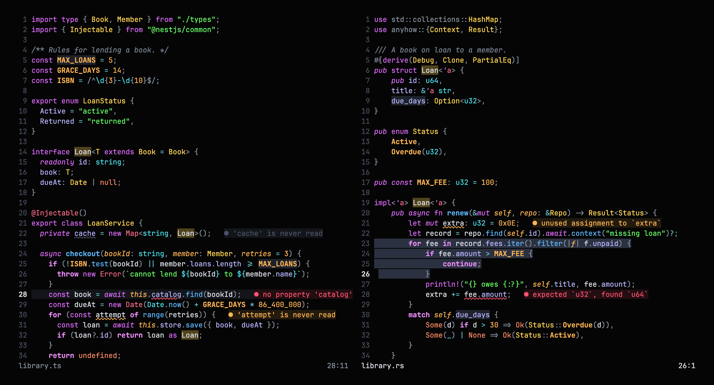

# oz-theme.nvim

A vibrant dark Neovim colorscheme on a near-black background (`#050505`).
Written in Lua, tree-sitter first, no dependencies.



## Install

[lazy.nvim](https://github.com/folke/lazy.nvim):

```lua
{
  "0OZ/oz-theme.nvim",
  lazy = false,
  priority = 1000,
  config = function()
    vim.cmd.colorscheme("oz-theme")
  end,
}
```

[LazyVim](https://www.lazyvim.org): add the plugin spec above (without `config`),
then set the colorscheme:

```lua
{ "LazyVim/LazyVim", opts = { colorscheme = "oz-theme" } }
```

Tested on Neovim 0.12 and 0.13-dev.

## What it does

- **One color, one role.** Properties are lavender, annotations pink, constants
  bold orange, `null`/`nil`/`true`/`false` coral, module paths muted, operators a
  dimmer cyan than builtins. Declarations are bold, calls stay plain; control flow
  (`if`, `return`, `throw`, loops) is bold bright magenta, modifiers are italic.
- **Soft backgrounds.** Cursor line, selection, word under cursor, search, diff and
  diagnostic virtual text are tinted from the accent colors and stay readable
  (contrast of 4.5 or better against the text on top).
- **No flicker on LSP attach.** Semantic-token groups link to the same tree-sitter
  groups, or are cleared where tree-sitter knows more (declaration vs call,
  keyword roles), so colors do not change when a language server connects.
- **Kotlin.** `after/queries/kotlin/highlights.scm` makes `as`, `is`, `in` read as
  keywords and generic `<>` as brackets.

Plugin groups included: gitsigns, telescope, nvim-tree, neo-tree, nvim-cmp,
indent-blankline, illuminate, navic/barbecue, which-key, lazy, mason, noice,
notify, mini, trouble, flash, bufferline, dashboard, alpha, fidget, leap,
rainbow-delimiters.

## Customize

The palette is a plain table, `require("oz-theme").colors`. Soft backgrounds are
derived from the accents in `lua/oz-theme/init.lua` (see the `TINT` table); lower a
value there for a subtler tint. To override one group, set it after the colorscheme:

```lua
vim.cmd.colorscheme("oz-theme")
vim.api.nvim_set_hl(0, "CursorLine", { bg = "#101216" })
```

## Develop

```sh
nvim --clean --headless --cmd "set rtp+=." -l tests/smoke.lua
```

Regenerate the screenshot after a palette change:

```sh
scripts/screenshot/run.sh
```

It opens `scripts/screenshot/samples/` in a seeded nvim session (two splits, a
search, reference highlights, diagnostics, a Visual selection) inside a detached
tmux pane, renders the captured screen to HTML and shoots it with headless Chrome.
Needs `tmux`, `python3`, Google Chrome (or `CHROME=/path/to/chrome`) and
nvim-treesitter parsers for TypeScript and Rust. The font is JetBrains Mono Nerd
Font when installed, `monospace` otherwise.

## License

MIT
